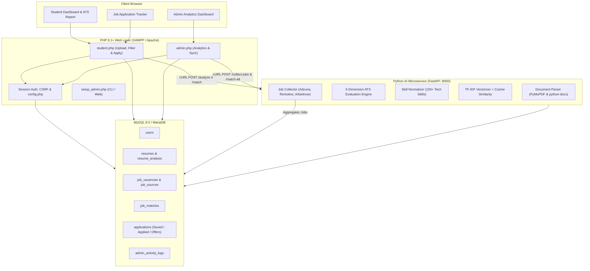

# AI Resume Analyzer & Semantic Job Matcher

[](https://www.php.net/)
[](https://www.python.org/)
[](https://fastapi.tiangolo.com/)
[](https://www.mysql.com/)
[](https://getbootstrap.com/)
[](LICENSE)

An enterprise-ready, full-stack AI platform designed to evaluate resumes against automated **Applicant Tracking Systems (ATS)**, extract technical skills using context-aware NLP, calculate semantic job match scores using **TF-IDF cosine similarity**, aggregate live vacancies across free job boards, provide curated **free upskilling course links** for missing skills, and empower students with a complete **Job Application Tracker**.

---

## Architecture Overview



---

## Key Features

### 1. ATS Resume Evaluation & Actionable Scorecard
- **Multi-Format Extraction**: Parses text and embedded data tables from both `.pdf` (using PyMuPDF) and `.docx` (using python-docx).
- **5-Dimensional ATS Score (0 - 100)**:
  - **Contact Information (15 pts)**: Email, phone number, LinkedIn/GitHub links.
  - **Core Resume Sections (35 pts)**: Education, Experience, Technical Projects, Skills, Certifications.
  - **Technical Skill Density (25 pts)**: Frequency and presence of recognized technology stack keywords.
  - **Action Verbs & Quantified Results (15 pts)**: Scans for action verbs (*engineered, developed, optimized, automated*) and metrics (*percentages, scales, impact numbers*).
  - **Formatting & Word Count (10 pts)**: Penalizes overly short or verbose documents; targets 300–900 words.
- **Actionable ATS Suggestions**: Pinpoints missing sections and suggests specific resume improvements.

### 2. Intelligent Skill Extraction & Normalization
- Recognizes **150+ technology skills** spanning Programming Languages, Web Frameworks, Databases, AI/ML, Cloud/DevOps, and Cybersecurity.
- Boundary-aware regex prevents false matches (e.g., `c`, `r`, `go`).
- Normalizes synonyms (e.g., `react.js` &rarr; `react`, `nodejs` &rarr; `node.js`, `k8s` &rarr; `kubernetes`).

### 3. Smart Semantic Job Matcher
- **Dual Matching Algorithm**:
  $$\text{Match Score} = 60\% \times (\text{Technical Skill Overlap}) + 40\% \times (\text{TF-IDF Cosine Similarity})$$
- Categorizes compatibility into **Strong Match** (80%+), **Good Match** (65%+), **Partial Match** (45%+), and **Low Match**.
- Highlights **Matching Skills** (green badges) vs. **Missing Skills** (red badges).

### 4. Automated Upskilling Recommendations
- Automatically maps missing skills to free learning resources:
  - **Coursera** free audit courses (e.g., Andrew Ng's Machine Learning, Python for Everybody).
  - **freeCodeCamp** interactive certifications and video courses.
  - **NPTEL / SWAYAM** government curriculum lectures.

### 5. Multi-Source Job Vacancy Ingestion
- **Remotive API**: Global remote developer and DevOps positions.
- **Arbeitnow API**: International engineering job postings.
- **Autonomous Fallback Seed Jobs**: Ensures students always have realistic tech openings out-of-the-box even without external API credentials or internet connectivity.
- Background scheduler updates job listings every 6 hours and archives stale postings (> 60 days).

### 6. Student Application Tracker
- Directly integrated into `student.php`.
- Track status per job: `Saved` &bull; `Applied` &bull; `Interview` &bull; `Offer` &bull; `Rejected`.
- Filter by status, inspect applied dates, and maintain complete control over job search progress.

### 7. Administrative Control Center
- High-level platform KPIs: Total Students, Uploaded Resumes, Active Jobs, Tracked Applications, and Average Platform ATS Score.
- **Live Job Source Sync**: Trigger job collection on-demand with one click.
- **Batch Re-matching**: Re-run semantic matching across all candidate resumes.
- **Market Intelligence**: Real-time badge cloud of the most demanded skills in current vacancies.
- **Student Performance Ledger**: View candidate details, best matching roles, and ATS scores.
- **Audit Logging**: Tracks administrative actions in `admin_activity_logs`.

---

## Tech Stack

| Component | Technology | Version | Description |
|---|---|---|---|
| **Web Frontend / Backend** | PHP | 8.1+ (8.5 ready) | Pure native PHP with PDO, CSRF tokens, responsive UI |
| **Styling & Icons** | Bootstrap & Bootstrap Icons | 5.3.3 / 1.11 | Modern responsive layout, score gauges, progress bars |
| **AI Microservice** | Python & FastAPI | 3.10+ / 0.100+ | Asynchronous REST microservice with CORS support |
| **NLP & Matching** | Scikit-learn & PyMuPDF | 1.3+ / 1.23+ | TF-IDF Vectorization, Cosine Similarity, PDF parsing |
| **Document Parsing** | python-docx & PyMuPDF | Latest | Paragraph and table text extraction from Word and PDF |
| **Database** | MySQL / MariaDB | 8.0+ / 10.4+ | Relational schema with foreign keys and cascade deletes |

---

## Directory Structure

```
ai_resume_platform/
├── .env.example               # Template for environment configuration
├── README.md                  # Comprehensive platform documentation
├── database/
│   └── schema.sql             # Complete database schema, tables & seed jobs
├── php_app/
│   ├── config.php             # Database PDO connection, .env parser, CSRF & UI helpers
│   ├── index.php              # Modern student & admin login portal
│   ├── register.php           # Student registration page
│   ├── student.php            # Resume upload, ATS scorecard, matches & application tracker
│   ├── admin.php              # Admin analytics dashboard, source sync & student roster
│   ├── change_password.php    # Password change & first-time login enforcement
│   ├── logout.php             # Secure session termination
│   └── setup_admin.php        # CLI & web administrator initialization script
└── python_ai/
    ├── app.py                 # FastAPI microservice (/analyze, /match, /collect-jobs)
    ├── common.py              # Skill dictionary, regex finder, database connector & courses
    ├── job_collector.py       # Aggregator for Adzuna, Remotive & Arbeitnow APIs
    └── requirements.txt       # Python package dependencies
```

---

## Step-by-Step Setup Guide

### 1. Prerequisites
- **XAMPP** (with Apache, MySQL, PHP 8.1 or higher) &rarr; [Download XAMPP](https://www.apachefriends.org/)
- **Python 3.10 or higher** with `pip` &rarr; [Download Python](https://www.python.org/)

---

### 2. Clone or Setup Project Directory
Clone the repository from GitHub:
```powershell
git clone https://github.com/SanjayGL-8123/ai-resume-matcher.git
cd ai-resume-matcher
```
*(If using XAMPP Apache, place or clone the folder inside `C:\xampp\htdocs\ai-resume-matcher`).*

---

### 3. Configure `.env` File
In the root of `ai_resume_platform`, copy `.env.example` to `.env`:
```powershell
Copy-Item .env.example .env
```
Open `.env` in any text editor and adjust your settings:
```env
DB_HOST=127.0.0.1
DB_PORT=3306
DB_USER=root
DB_PASS=
DB_NAME=resume_ai

# Google Gemini AI API Configuration (Optional - for LLM-powered resume feedback)
# Free key from Google AI Studio: https://aistudio.google.com/
GOOGLE_API_KEY=
GEMINI_API_KEY=

# Master Admin Setup
ADMIN_USERNAME=admin
ADMIN_PASSWORD=Admin@123
```

---

### 4. Initialize Database
1. Open the **XAMPP Control Panel** and start **MySQL** (and Apache if using XAMPP).
2. Open your browser and go to [http://localhost/phpmyadmin](http://localhost/phpmyadmin).
3. Click the **Import** tab.
4. Select the file: `database/schema.sql` (or `C:\xampp\htdocs\ai_resume_platform\database\schema.sql`).
5. Click **Import** (or **Go**).
   *(This creates the `resume_ai` database, all necessary tables, default sources, and initial demo tech jobs).*

---

### 5. Setup & Launch Python AI Microservice
Open a terminal window:
```powershell
cd python_ai

# Install dependencies
pip install -r requirements.txt

# Start the FastAPI microservice
uvicorn app:app --host 127.0.0.1 --port 8000 --reload
```
You should see:
```
INFO:     Uvicorn running on http://127.0.0.1:8000 (Press CTRL+C to quit)
```
> Verify the AI microservice by visiting [http://127.0.0.1:8000/docs](http://127.0.0.1:8000/docs) in your browser for the interactive Swagger UI.

---

### 6. Start the PHP Web Application

You can launch the web portal using either method:

#### Method A: Built-in PHP Server (Fastest — No Apache setup needed!)
In a new terminal window:
```powershell
php -S localhost:8080 -t php_app
```
Then visit: **[http://localhost:8080/](http://localhost:8080/)**

#### Method B: Via XAMPP Apache
Start **Apache** in XAMPP Control Panel and visit:
```
http://localhost/ai_resume_platform/php_app/
```

---

### 7. Ready-to-Use Login Credentials

The platform comes with pre-configured accounts ready for instant testing:

| Role | Username / Email | Password | Access URL | Permissions / Capabilities |
|---|---|---|---|---|
| **Administrator** | `admin` *(or `admin@local.system`)* | `Admin@123` | `http://localhost:8080/admin.php` | System KPIs, sync live job sources, re-match resumes, market intelligence |
| **Demo Student** | `student` *(or `student@demo.local`)* | `Student@123` | `http://localhost:8080/student.php` | Upload resume, view ATS score breakdown, Gemini AI review, track job applications |

*(You can also create brand-new student accounts anytime at `http://localhost:8080/register.php`)*.

---

### 8. (Optional) Ingest Live Tech Jobs
To collect additional real-time job openings immediately:
```powershell
cd python_ai
python job_collector.py
```
*(Alternatively, log in as Admin and click **"Sync Job Sources"** directly inside the web dashboard).*

---

## User Workflows

### Student Workflow
1. Navigate to: `http://localhost/ai_resume_platform/php_app/register.php`.
2. Register an account (Name, Username, Email, Password).
3. Upload your resume in `.pdf` or `.docx` format.
4. Review your **ATS Compatibility Score (0–100)**, missing sections, and suggestions.
5. Browse **Matching Jobs** with match percentages, highlighted skill gaps, and free course links.
6. Use the **My Status** dropdown on any job card to set status to `Saved`, `Applied`, `Interview`, etc.
7. Switch to the **My Application Tracker** tab to manage your ongoing applications.

### Administrator Workflow
1. Log in at `http://localhost/ai_resume_platform/php_app/index.php` using your admin credentials.
2. Complete the mandatory initial password update.
3. Access the **Admin Dashboard**:
   - Inspect overall platform health and candidate performance.
   - Click **"Sync Job Sources"** to pull live jobs from external APIs in the background.
   - Click **"Re-match All Resumes"** to re-evaluate all resumes against new job postings.
   - View the top in-demand skills currently trending across active job postings.
   - Audit system activities in the activity log.

---

## FastAPI Microservice Endpoints

| Method | Endpoint | Description |
|---|---|---|
| `GET` | `/` | Microservice status and version information |
| `GET` | `/health` | Health check verifying MySQL connectivity |
| `POST` | `/analyze` | Multipart upload parsing resume, ATS score, skills & suggestions |
| `POST` | `/match/{resume_id}` | Computes semantic job match scores for a specific resume |
| `POST` | `/match-all` | Batch recalculates matches across all resumes |
| `POST` | `/collect-jobs` | Triggers background job collection from external APIs |

---

## Troubleshooting

### 1. `Database Connection Error` in Browser
- Ensure MySQL is active (green indicator) in the XAMPP Control Panel.
- If MySQL in XAMPP runs on port `3307` instead of default `3306`, update `DB_PORT=3307` in your `.env`.
- Ensure you have imported `database/schema.sql` into phpMyAdmin.

### 2. `AI Microservice is not reachable`
- Ensure you started `uvicorn app:app --port 8000` in the `python_ai` directory.
- Confirm `http://127.0.0.1:8000` opens in your browser and returns `{"service": "AI Resume & Job Matcher API", "status": "online"}`.

### 3. `Could not read text (scanned PDF?)`
- The system parses text-based PDFs and Word documents. If a PDF is a scanned image/photo without embedded text, convert it using OCR or save the document as a native Word `.docx` or searchable PDF.

### 4. PHP 8.5+ Compatibility
- Deprecated functions like `curl_close()` have been removed and replaced with standard `CurlHandle` garbage collection via `ai_post()`.

---

## Security Best Practices
- **Environment File**: Never commit `.env` containing production passwords or API secrets to public version control.
- **Default Passwords**: Always update default passwords immediately upon initial installation.
- **File Upload Protection**: Uploads are restricted by extension (`.pdf`, `.docx`), MIME type, and size limit (6 MB max).
- **CSRF & SQL Injection**: Every form request is validated with anti-CSRF tokens and all database operations use parameterized PDO prepared statements.

---

## License

This project is open-source and licensed under the **[MIT License](LICENSE)** &copy; 2026 Sanjay G L.

```text
MIT License
Copyright (c) 2026 Sanjay G L
```

### Permissions & Conditions
- **Permissions**: Commercial use, Modification, Distribution, Private use.
- **Conditions**: Preservation of copyright and license notice.
- **Limitations**: No liability, No warranty.

For the full legal text, refer to the [LICENSE](LICENSE) file.
